<!-- PeaceD OPC - Nghiên cứu và Phát triển bởi Nguyễn Hữu Dũng (MSV: 11235559) -->
<h1 align="center">
  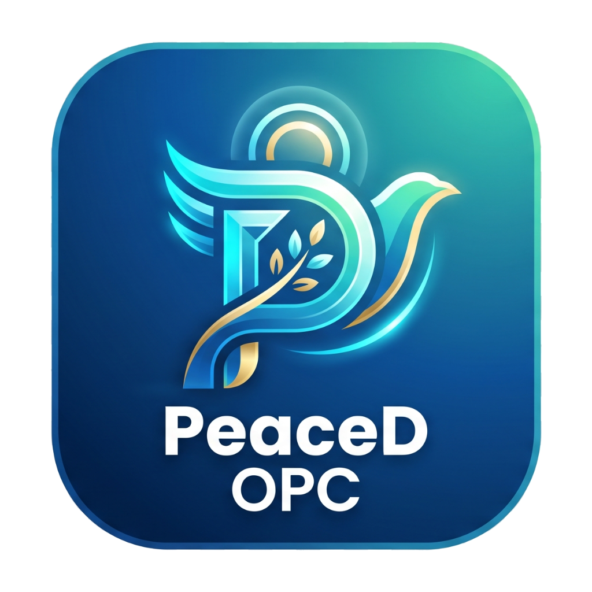 PeaceD OPC
</h1>

<p align="center">
  <strong>Hệ Thống Quản Trị &amp; Điều Phối Đa Tác Nhân Trí Tuệ Nhân Tạo Trong Kỹ Nghệ Phần Mềm</strong><br/>
  <em>(Multi-Stream AI Coding Agent Orchestration &amp; Governance Platform)</em>
</p>

<p align="center">
  
  
  
  
  
</p>

<p align="center">
  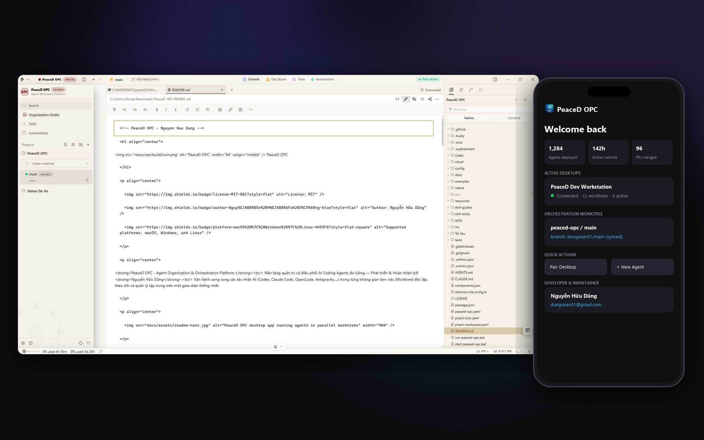
</p>

---

## 💡 Đặt Vấn Đề & Ý Tưởng Nghiên Cứu (Research Context & Ideation)

Trong kỷ nguyên phát triển mạnh mẽ của Trí tuệ Nhân tạo Tạo sinh (Generative AI), các **Tác nhân Lập trình Tự hành (AI Coding Agents)** như Claude Code, OpenAI Codex, Google Antigravity, Cursor, Devin,... đang dần trở thành trợ thủ đắc lực trong kỹ nghệ phần mềm. Tuy nhiên, quy trình ứng dụng thực tế trong các tổ chức và dự án công nghệ đang đối mặt với những **rào cản quản trị nghiêm trọng**:

1. **Xung Đột Không Gian Làm Việc (Workspace Collision)**: Khi triển khai nhiều Agent hoặc yêu cầu nhiều tác vụ cùng lúc trên một mã nguồn cục bộ, các tiến trình sẽ ghi đè tệp tin của nhau, gây ra tình trạng phân mảnh ngữ cảnh và xung đột mã nguồn nghiêm trọng.
2. **Thiếu Khả Năng Thử Nghiệm Song Song (Lack of Parallel Experimentation)**: Lập trình viên khó có thể phân bổ cùng một bài toán kiến trúc cho 2 hoặc nhiều mô hình AI khác nhau để so sánh đối chứng hiệu quả và chọn ra phương án tối ưu một cách độc lập.
3. **Phân Mảnh Giám Sát & Tài Nguyên (Fragmented Telemetry & Governance)**: Không có một trung tâm điều hành hiển thị đồng thời trạng thái, tiến độ thực thi, tài nguyên tính toán và chi phí token của từng tác nhân.
4. **Hạn Chế Về Tính Di Động (Supervision & Mobility Gap)**: Các tác vụ phân tích, tái cấu trúc hoặc sinh mã lớn thường kéo dài từ vài chục phút đến nhiều giờ, buộc kỹ sư phải túc trực bên máy tính bàn mà không thể giám sát hay can thiệp kịp thời từ thiết bị di động.

### 🎯 Giải Pháp Đề Xuất: Nền Tảng PeaceD OPC
Được nghiên cứu, thiết kế kiến trúc và phát triển bởi **Nguyễn Hữu Dũng**, **PeaceD OPC** là một **Môi trường Phát triển và Quản trị Tích hợp (Orchestration IDE)** toàn diện. Nền tảng ứng dụng công nghệ **Phân lập Không gian Làm việc Song song (Git Worktree Partitioning)** kết hợp với **Hạt nhân Terminal Đa luồng Gia tốc Phần cứng (Hardware-Accelerated Terminal Splicer)** và **Mạng Chuyển tiếp Di động Bảo mật Đầu cuối (E2EE Relay Network)**, cho phép một kỹ sư duy nhất có thể chỉ huy, giám sát và khai thác tối đa sức mạnh của một "đội ngũ" AI Agent cùng lúc với độ tin cậy và an toàn mã nguồn tuyệt đối.

---

## 🌟 Kiến Trúc & Các Phân Hệ Chức Năng Cốt Lõi (Core Functional Modules)

<table>
<tr>
<td width="50%" valign="middle">

### 🌿 1. Phân Hệ Phân Lập Không Gian Tác Vụ Song Song (Multi-Stream Worktree Partitioning)

Ứng dụng cơ chế Git Worktree cấp thấp để tự động phân tách từng tác nhân AI vào một không gian làm việc vật lý hoàn toàn biệt lập từ cùng một kho mã nguồn. Kỹ sư có thể giao cùng một yêu cầu cho nhiều Agent xử lý đồng thời, dễ dàng so sánh giải pháp và chỉ hợp nhất (merge) phiên bản đạt chất lượng cao nhất vào nhánh chính.

</td>
<td width="50%">
  <picture><source srcset="docs/site/public/docs/tab-split.gif" type="image/gif">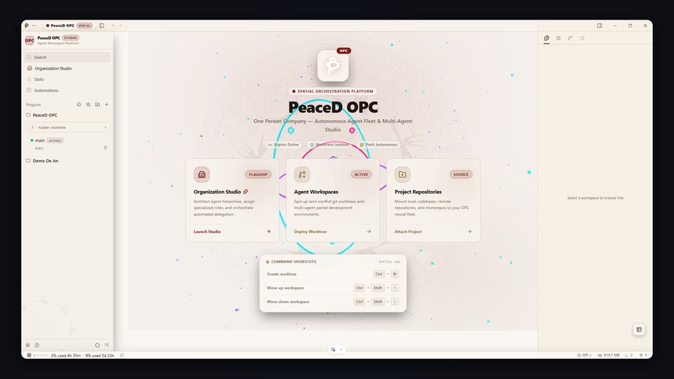</picture>
</td>
</tr>
<tr>
<td width="50%" valign="middle">

### 📱 2. Module Giám Sát &amp; Điều Khiển Di Động Đa Nền Tảng (Cross-Device Management Console)

Cho phép lập trình viên theo dõi tiến độ công việc, xem luồng xuất dữ liệu của Agent và trực tiếp gửi bổ sung chỉ dẫn hoặc phê duyệt (prompt injection) ngay từ điện thoại thông minh. Mọi thông tin thông báo hoàn thành tác vụ được đẩy tức thời qua hạ tầng Push Gateway (APNs &amp; FCM).

</td>
<td width="50%">
  <picture><source srcset="docs/assets/feature-wall/mobile-companion-app-showcase.gif" type="image/gif">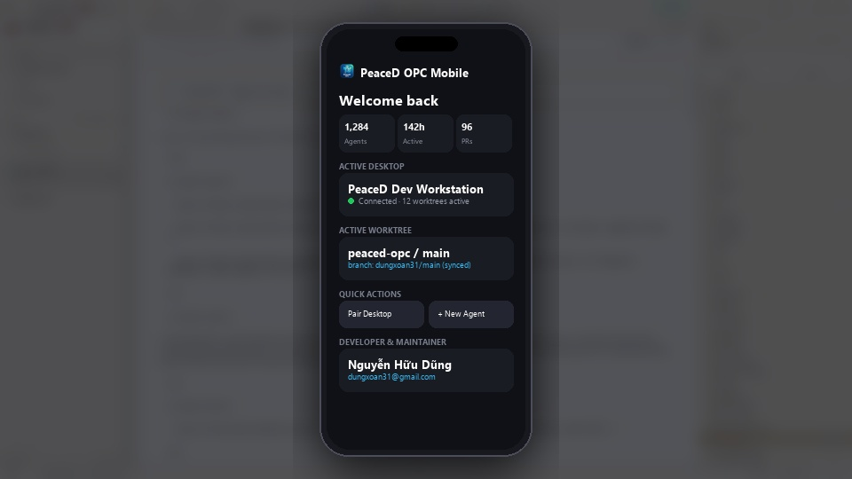</picture>
</td>
</tr>
<tr>
<td width="50%" valign="middle">

### ⚡ 3. Hạt Nhân Console Gia Tốc Đồ Họa Đa Luồng (Hardware-Accelerated Terminal Engine)

Bộ xử lý luồng giả lập terminal (PTY) hiệu năng cao được tăng tốc bằng WebGL, hỗ trợ chia tách giao diện không giới hạn (Terminal Splits), khả năng duy trì trạng thái phiên liên tục và bảo toàn lịch sử lệnh qua các phiên khởi động.

</td>
<td width="50%">
  <picture><source srcset="resources/onboarding/feature-wall/tile-02.gif" type="image/gif">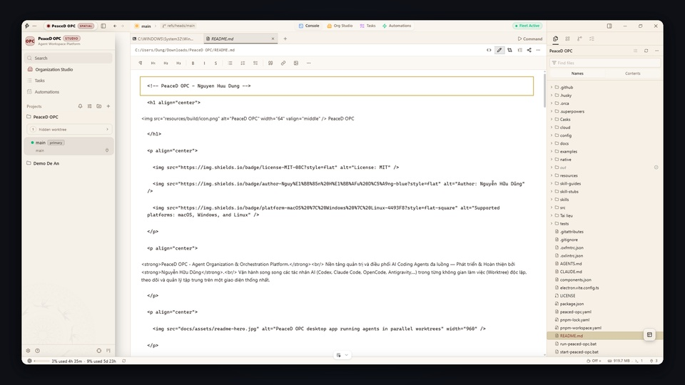</picture>
</td>
</tr>
<tr>
<td width="50%" valign="middle">

### 🎨 4. Trực Quan Hóa &amp; Trích Xuất Ngữ Cảnh Giao Diện (Visual UI Context Extractor)

Tích hợp trực tiếp trình duyệt Chromium nội vi, cho phép kỹ sư chỉ định trực quan bất kỳ thành phần giao diện nào trên màn hình để tự động trích xuất cấu trúc HTML, thuộc tính CSS và ảnh chụp thực tế đưa thẳng vào ngữ cảnh prompt của Agent.

</td>
<td width="50%">
  <picture><source srcset="docs/site/public/docs/peaced-opc-design-mode.gif" type="image/gif">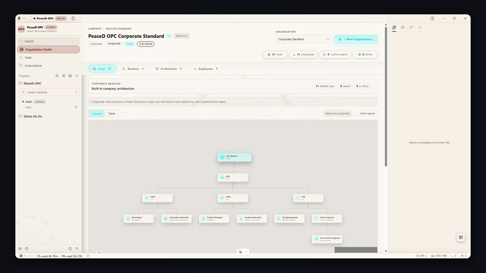</picture>
</td>
</tr>
<tr>
<td width="50%" valign="middle">

### 🐙 5. Đồng Bộ Hóa Quy Trình Quản Trị Dự Án (ALM &amp; Task Lifecycle Synchronization)

Tích hợp liền mạch với hệ thống quản lý công việc và kho lưu trữ (GitHub, Linear,...), cho phép chuyển đổi một Issue hoặc Task thành một không gian làm việc Worktree độc lập chỉ bằng một cú nhấp chuột, giúp quy trình từ nhận việc đến review mã nguồn diễn ra tập trung.

</td>
<td width="50%">
  <picture><source srcset="resources/onboarding/feature-wall/tile-03.gif" type="image/gif">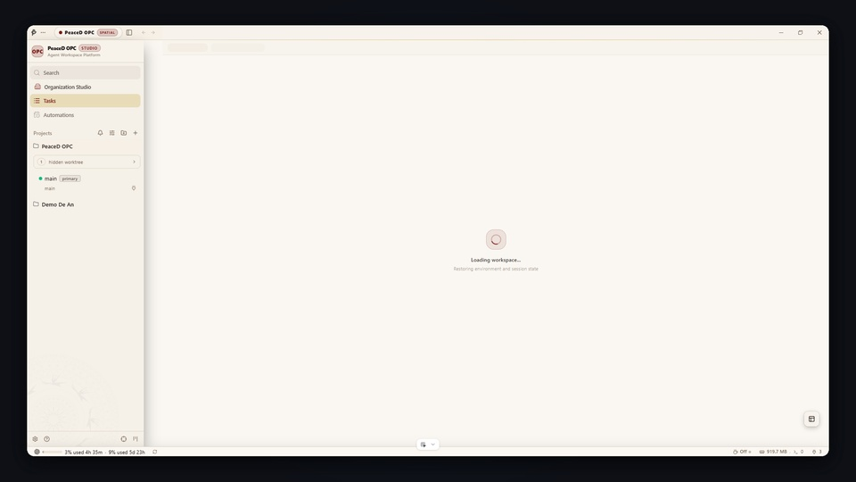</picture>
</td>
</tr>
<tr>
<td width="50%" valign="middle">

### 🌐 6. Môi Trường Thực Thi Phân Tán Trên Máy Chủ (Remote Execution Cluster via SSH)

Cho phép mở rộng việc thực thi các AI Agent lên các cụm máy chủ hoặc trạm làm việc hiệu năng cao từ xa qua giao thức SSH an toàn. Hỗ trợ đầy đủ cơ chế tái kết nối tự động, chỉnh sửa tệp tin từ xa và chuyển tiếp cổng mạng (port forwarding).

</td>
<td width="50%">
  <picture><source srcset="resources/onboarding/feature-wall/tile-06.gif" type="image/gif">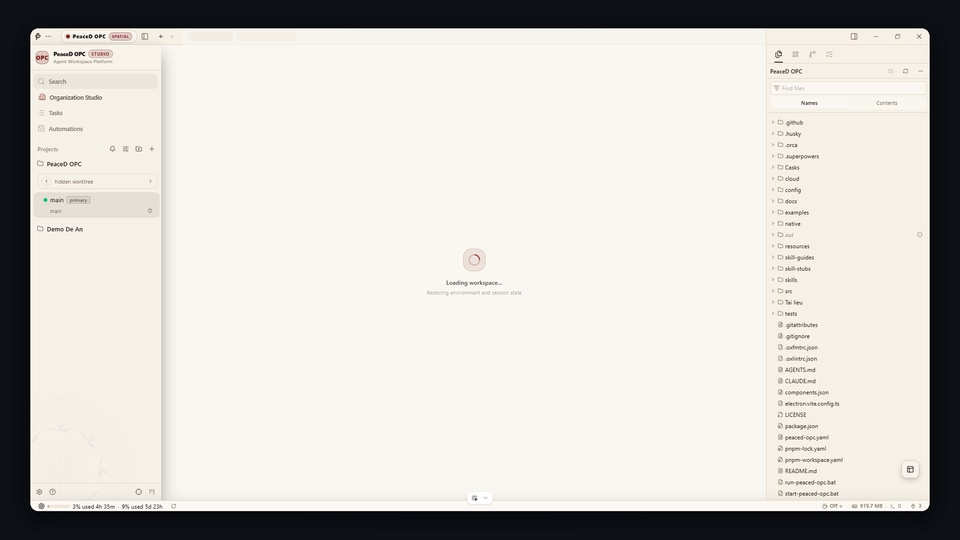</picture>
</td>
</tr>
<tr>
<td width="50%" valign="middle">

### ✍️ 7. Kiểm Duyệt Mã Nguồn &amp; Tương Tác Phản Hồi Trực Tiếp (Interactive Code Audit &amp; Diff Review)

Cung cấp công cụ so sánh trực quan sai khác mã nguồn (Diff viewer) thế hệ mới, cho phép lập trình viên gắn cờ bình luận, chỉnh sửa trực tiếp trên từng dòng mã do AI sinh ra trước khi tạo bản cam kết commit.

</td>
<td width="50%">
  <picture><source srcset="docs/site/public/docs/annotate-ai-diff.gif" type="image/gif">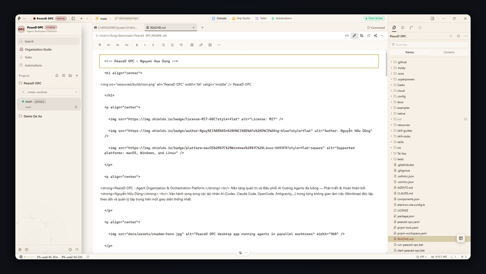</picture>
</td>
</tr>
<tr>
<td width="50%" valign="middle">

### 📂 8. Cơ Chế Nạp Ngữ Cảnh Đa Phương Tiện Trực Quan (Multimodal Context Ingestion)

Trình soạn thảo ngữ cảnh trực quan thông minh hỗ trợ kéo thả trực tiếp tệp tin dữ liệu, tài liệu thiết kế hoặc hình ảnh giao diện vào bảng lệnh của Agent để phục vụ các bài toán xử lý đa phương thức (Multimodal AI).

</td>
<td width="50%">
  <picture><source srcset="resources/onboarding/feature-wall/tile-07.gif" type="image/gif">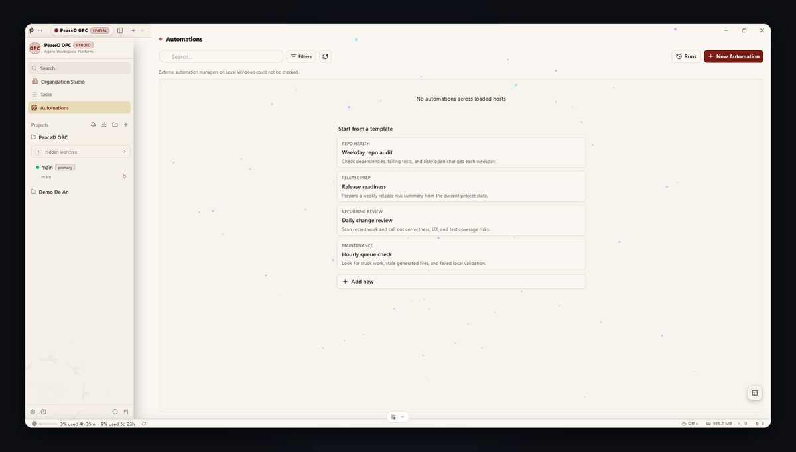</picture>
</td>
</tr>
<tr>
<td width="50%" valign="middle">

### 💻 9. Giao Diện Dòng Lệnh Tự Động Hóa Quản Trị Hệ Thống (PeaceD Automation CLI Engine)

Cung cấp công cụ dòng lệnh mạnh mẽ (`peaced-opc`, `opc`), cho phép tự động hóa quy trình quản lý không gian làm việc, chụp bản sao lưu trạng thái (snapshots) và lập trình kịch bản tích hợp vào chuỗi phân phối tự động CI/CD.

</td>
<td width="50%">
  <picture><source srcset="resources/onboarding/feature-wall/tile-09.gif" type="image/gif">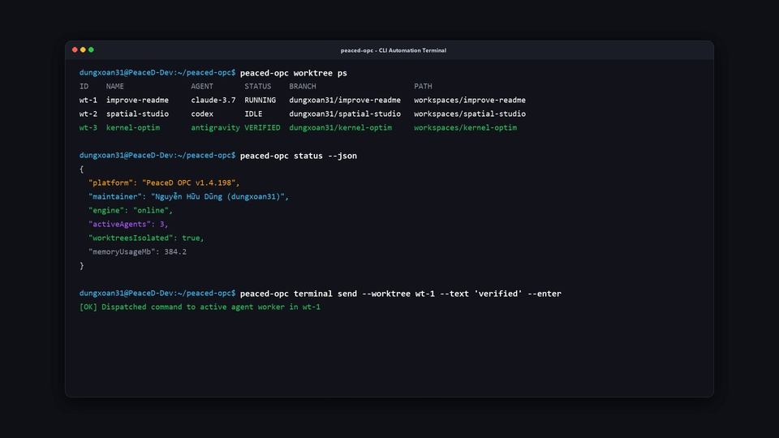</picture>
</td>
</tr>
</table>

---

## 🤖 Hệ Sinh Thái Tác Nhân Được Tích Hợp (Supported Agent Ecosystem)

PeaceD OPC được thiết kế với kiến trúc **Adapter Mở**, tương thích độc lập và sẵn sàng vận hành cùng **mọi Tác nhân CLI Agent**:

<p>
  <kbd> Claude Code</kbd> &nbsp;
  <kbd> OpenAI Codex</kbd> &nbsp;
  <kbd> xAI Grok</kbd> &nbsp;
  <kbd> Cursor CLI</kbd> &nbsp;
  <kbd> GitHub Copilot</kbd> &nbsp;
  <kbd> OpenCode</kbd> &nbsp;
  <kbd> OpenClaude</kbd> &nbsp;
  <kbd> Google Antigravity</kbd> &nbsp;
  <kbd> Hermes Agent</kbd> &nbsp;
  <kbd> Devin</kbd> &nbsp;
  <kbd> Droid</kbd> &nbsp;
  <kbd> Moonshot Kimi</kbd> &nbsp;
  <kbd> Alibaba Qwen Code</kbd> &nbsp;
  <kbd>+ Bất kỳ Tác nhân CLI nào khác</kbd>
</p>

---

## 🛠️ Hướng Dẫn Cài Đặt &amp; Khởi Chạy (Installation &amp; Deployment)

### Yêu Cầu Môi Trường (System Prerequisites)
- **Node.js**: Phiên bản 20.x LTS trở lên.
- **Trình quản lý gói**: `pnpm` (khuyến nghị phiên bản >= 9.x).
- **Hệ thống quản lý phiên bản**: `Git` (khuyến nghị phiên bản >= 2.25 để tương thích hoàn toàn tính năng Worktree nâng cao).

### Quy Trình Khởi Chạy Nhanh (Quick Start)

1. **Sao chép mã nguồn đề án:**
   ```bash
   git clone https://github.com/dungxoan31-creator/PeaceD_OPC.git
   cd PeaceD_OPC
   ```

2. **Cài đặt toàn bộ thư viện phụ thuộc:**
   ```bash
   pnpm install
   ```

3. **Khởi chạy ứng dụng trong môi trường phát triển (Development Mode):**
   ```bash
   pnpm dev
   ```

4. **Đóng gói bộ cài đặt hoàn chỉnh (Production Packaging):**
   ```bash
   # Đóng gói cho hệ điều hành Windows (.exe)
   pnpm build:win

   # Đóng gói cho hệ điều hành macOS (.dmg / .zip)
   pnpm build:mac

   # Đóng gói cho hệ điều hành Linux (.AppImage / .deb)
   pnpm build:linux
   ```

---

## 👤 Thông Tin Tác Giả &amp; Bản Quyền Đề Án (Author &amp; Intellectual Property)

- **Sinh viên thực hiện**: **Nguyễn Hữu Dũng**
- **Mã sinh viên (Student ID)**: **11235559**
- **Chuyên ngành đào tạo**: Hệ Thống Thông Tin Quản Lý (MIS)
- **Đề tài**: *Nghiên cứu &amp; Xây dựng Nền tảng Quản trị Điều phối Đa Tác nhân AI trong Kỹ nghệ Phần mềm — PeaceD OPC*
- **Kênh GitHub chính thức**: [@dungxoan31-creator](https://github.com/dungxoan31-creator)
- **Kho lưu trữ mã nguồn**: [https://github.com/dungxoan31-creator/PeaceD_OPC](https://github.com/dungxoan31-creator/PeaceD_OPC)

### Tuyên Bố Bản Quyền (License &amp; Ownership)
Dự án được phân phối dưới giấy phép [MIT License](LICENSE).  
Toàn bộ ý tưởng kiến trúc, cấu hình thiết lập, mô hình quản trị và tài liệu hướng dẫn của đề án **PeaceD OPC** thuộc quyền sở hữu trí tuệ của tác giả **Nguyễn Hữu Dũng** (MSV: 11235559). Mọi quyền bảo lưu được áp dụng theo quy định hiện hành.
